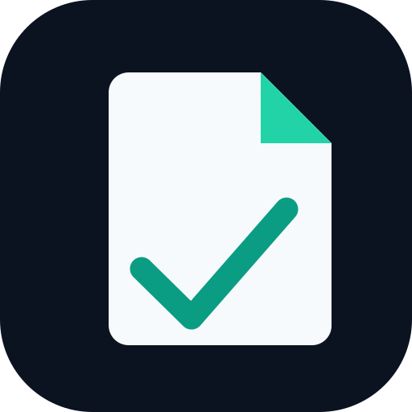
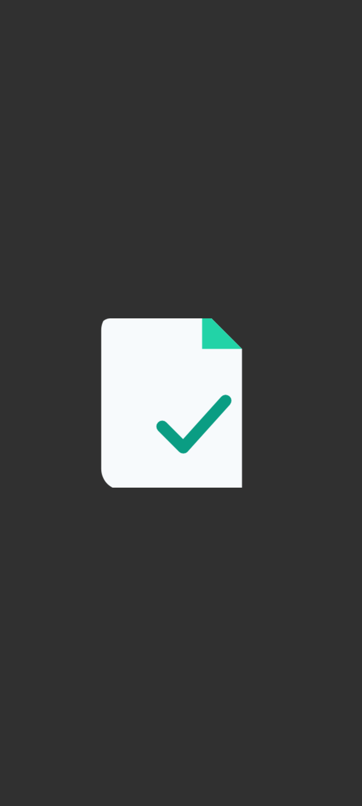

  
  <h1>FOLQIO</h1>
  
<strong>Your documents. Your device.</strong>

  
Read, scan, organize, and share PDFs with a calm, beautifully focused workspace.

  

    
    
    
    
  

  

    <a href="https://github.com/bren-wp/Folqio/releases">Get Folqio</a>
    ·
    <a href="docs/SECURITY.md">Privacy</a>
    ·
    <a href="docs/DESIGN_QA.md">Design principles</a>
  

---

## One beautiful place for your PDFs

Folqio puts your documents first. Its dark midnight-navy interface, carefully balanced mint highlights, and familiar tools make everyday PDF work feel simple.

| | |
| --- | --- |
| **📖 Read with ease** | Open PDFs from your device, move between pages, zoom, and return to where you left off. |
| **📷 Capture documents** | Turn photos into PDFs. The iOS document camera supports multi-page scanning with automatic page detection. |
| **📁 Stay organized** | Find documents by name, rename library labels, save favorites, and keep recent files close. |
| **🧩 Work with pages** | Create multi-page PDFs, extract or rotate pages, and combine documents. Available page tools vary by platform. |
| **🔎 Find what matters** | Search selectable PDF text and recognize scanned text on iOS with on-device OCR. |
| **↗️ Share on your terms** | Export selected PDFs to a ZIP archive or share a document whenever you choose. |
| **🌍 Choose your language** | 25 choices for navigation and settings, including Croatian. |

## See Folqio in action

  
  
Actual Android app, captured on an emulator. No fabricated documents or simulated UI.

**Midnight navy · Slate · Mint.** Quiet surfaces, clear typography, comfortable controls, and a PDF page that stays the focus.

## Privacy is part of the experience

Folqio does not require a user account, run an advertising SDK, or send your PDF documents to a Folqio server. PDF processing happens locally with Android and Apple platform frameworks. iOS optical character recognition uses Apple's on-device Vision framework. Documents are shared through your device's system share sheet.

## Android and iOS

Both editions share Folqio's visual identity but use the strengths of their respective platforms.

**Android** brings a focused PDF reader, bookmarks, document library, photo-to-PDF creation, save/share, and page extraction, rotation, and merging as flattened copies.

**iPhone and iPad** add PDFKit text search, note and highlight annotations, multi-page document-camera scanning, on-device OCR, and page operations that retain PDF content.

**Important:** Main navigation and settings have translations; some other screens still appear in English. Android's extracted, rotated, and merged PDF copies are rasterized. Those operations do not preserve searchable text, forms, or signatures and must not be treated as secure redaction. Some advanced PDF editing features remain on the roadmap.

## Discover Folqio

Explore the [latest downloads and release notes](https://github.com/bren-wp/Folqio/releases), learn about our [privacy and security design](docs/SECURITY.md), or see the [full feature roadmap](docs/ROADMAP.md).

Folqio is an evolving preview. Production signing, real-device certification, and exact screen-by-screen visual parity remain subject to validation. Releases explicitly identify development-only assets.

---

Folqio is an independent open-source project released under the [MIT License](LICENSE).
